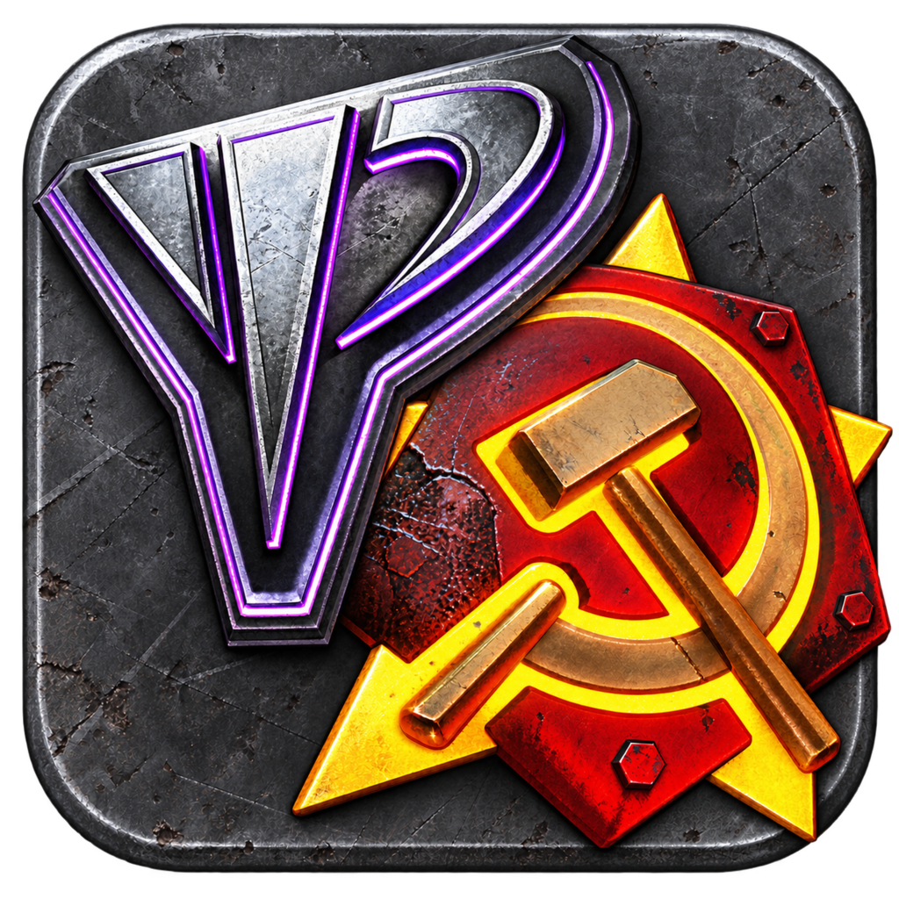
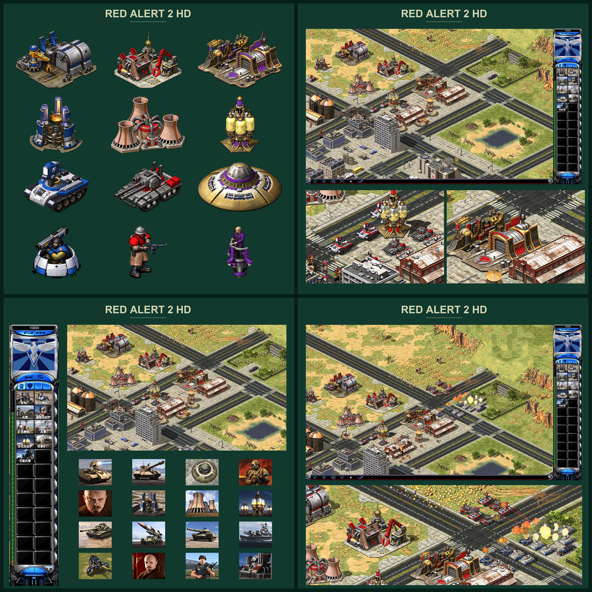

# Red Alert 2 HD · 红色警戒 2 高清重制

[中文](#中文介绍) · [English](#english)



[](docs/images/ra2-hd-showcase.jpg)

<a id="中文介绍"></a>

## 项目介绍

基于 TypeScript、React、Three.js 和 Electron 实现的《命令与征服：红色警戒 2》及《尤里的复仇》离线桌面高清重制项目。在 macOS 和 Windows 上提供本地 AI 遭遇战，高清化三阵营美术、地图环境和界面，同时以保留原版玩法规则和等距视角表现为兼容目标。

### 参考项目与本项目实现

代码基于 [huangkaoya/ts-redalert2](https://github.com/huangkaoya/ts-redalert2)，此前仓库地址为 `huangkaoya/redalert2`。该项目说明其来源是对 RA2WEB（[Chrono Divide](https://chronodivide.com/) 中文改编版）的分析；Chrono Divide 是使用网页技术重现红警 2 的项目。

本项目在这一基础上实现双版本离线游戏、高清资源管线、完整遭遇战地图环境覆盖、本地化桌面界面和本地资源打包。TypeScript 负责游戏与资源逻辑，React 构建界面，Three.js 渲染战场，Electron 提供桌面窗口和本地资源访问。游戏通过这一引擎运行，不会启动或修改原版 Windows 游戏可执行文件。

高清化以改善画面为重点，不为放置更大的美术而改变单位占地、建筑位置、移动距离或战斗规则。引擎兼容性、AI 行为与美术还原是不同问题；内置 AI 并不是原版游戏可执行文件中的 AI。

### 游戏体验

- **双版本切换：**选择红警 2 或尤里的复仇，使用对应阵营、单位、建筑和地图。
- **离线遭遇战：**对战多个 AI，在地图出生点数量限制内选择阵营、队伍和玩家位置；所有支持的地图统一使用标准遭遇战设置。
- **原图、2X 与 4X：**可选择原版画面或高清资源，高清资源组无法完整加载时提供回退。
- **稳定的显示尺度：**渲染分辨率与逻辑显示尺寸分开。在同一显示器、相同窗口视口下，提高输出分辨率会增加细节，不会缩小单位和界面或改变地图可视范围；窗口大小及宽高比变化可以改变可视面积。
- **三种界面语言：**英文、简体中文和繁体中文覆盖菜单、地图名称及游戏文本。
- **可选内置修改器：**可在主菜单或暂停菜单的选项中启用，提供对局内按钮和可配置快捷键；关闭后隐藏工具栏。
- **独立桌面运行：**支持全屏、窗口化、设置保存、对局结算、返回菜单和再次开局。

### 已高清化的内容

美术覆盖盟军、苏军、尤里三阵营，以及支持的原版遭遇战地图所使用的环境。世界资源提供 2X 和 4X 两种密度；界面使用适合其显示方式的高清图片和文字渲染。

| 类别 | 高清化范围 |
| --- | --- |
| 阵营建筑 | 三阵营建筑、防御设施及超级武器建筑，包括适用的雪地外观、受损状态和动态部件。 |
| 建造动画 | 按原版对应动画帧制作建筑建造序列，保持位置、时序以及与建筑生命周期的衔接。 |
| 步兵 | 阵营步兵及版本专属单位，包含移动、战斗等受支持动作、阵营色和原生阴影。 |
| 车辆、飞行器及舰船 | 阵营单位外观、多朝向、适用的独立车体与炮塔，以及受支持的展开和特殊状态。 |
| 地形 | 温带、雪地、城市、新城市和沙漠五类环境中的地表、斜坡、悬崖、海岸、水面、道路、桥梁和城市地形。 |
| 地图物件 | 支持的遭遇战地图内的平民与科技建筑、植被、装饰、围墙、栅栏、大门、矿石、宝石及其他覆盖层。 |
| 菜单与画面 | 主菜单美术、界面背景、按钮、加载图片和遭遇战胜负结算画面。 |
| 建造侧栏 | 三阵营建筑和单位图标、适用的军衔别名及超级武器图标。 |
| 对局显示 | 游戏风格光标、指令和状态标识、血条、悬停名称及可缩放界面文字。 |

地图目录包含 **62 张红警 2 地图和 151 张尤里的复仇地图**，遵循各版本原版公布列表及顺序，共 213 张。地图按所属环境复用高清资源。这一覆盖范围不包括任意自定义地图和仅存于归档、未列入原版目录的额外地图。

### 高清显示如何实现

高密度美术按照原版精灵帧和逻辑坐标注册，因此更精细的步兵、坦克或建筑仍保留原有玩法占地。动画状态、朝向、阵营颜色替换、阴影和深度关系与实际对局联动，包括建筑遮挡、桥梁和高低地形表现。

资源按完整兼容组加载；无法使用某个高清组时，回退到可用的较低密度或原图，避免出现半套资源。世界画面保留原图模式。资源密度与输出分辨率互相独立：4X 美术提供更多源细节，更高的渲染分辨率提供更多显示像素。

最终效果来自重绘细节与足够显示像素的结合，不依赖扩大物体的玩法尺寸，也不表示所有原版特效、影片和音效都已重制。

### 桌面应用与资源

| 平台 | 完整包 | 纯程序包 |
| --- | --- | --- |
| macOS Apple Silicon | 单个 `Red Alert 2 HD.app` 内置所需本地资源，可以整体移动。 | 体积较小的应用，使用共用 `GameResources` 目录。 |
| Windows x64 | 免安装目录包含可执行文件、运行库和 `GameResources`，需保留整个目录。 | 较小的程序目录，使用与 macOS 相同的共用资源。 |

共用资源与平台无关，可拆成多个独立 ZIP。将全部分包解压到同一位置，即可组成一个 `GameResources` 目录。程序可在应用或可执行文件旁，以及用户数据目录内找到该目录：

- macOS：`~/Library/Application Support/Red Alert 2 HD`
- Windows：`%APPDATA%/Red Alert 2 HD`

移动或更换应用时，设置保留在用户数据目录。安装好本地资源后，不需要在线账号或运行时下载。macOS 是主要验证平台；提供 Windows 程序包，但新整合版本的性能与兼容性仍需 Windows 实机验证。不支持 Intel Mac。

### 源码与开发

本仓库保存源码及相关文档。导入的原版游戏归档、完整高清资源、预处理缓存和打包应用分别存放，**只克隆仓库不能直接游玩，也不能获得全部高清美术**。原版游戏数据需从合法拥有的本地安装导入。

使用 `.bun-version` 指定的 Bun 版本及已提交的锁文件：

```bash
bun install --frozen-lockfile --ignore-scripts
bun run typecheck:entry
bun run test:source
bun run build
```

完成本地资源导入与注册后，可用 `bun run start:offline` 启动构建后的应用。`desktop/` 和 `scripts/` 包含桌面打包与资源导入工具；`src/` 包含引擎、高清渲染及界面实现。

### 范围与权利说明

当前可玩内容以离线遭遇战为主。战役运行、战役影片、局域网和在线多人游戏尚未启用，预留菜单不表示这些模式已经实现。原版玩法是兼容目标，不表示与原版引擎完全等价。

本项目为非官方项目，与 Electronic Arts 或 Chrono Divide 团队没有隶属关系。命令与征服、红警 2、尤里的复仇及其原始资源的权利属于各自权利人。源码备份不包含原版游戏归档；包含本地导入游戏数据的私人完整包不作为公开分发资源包。

代码实际授权状态见 [LICENSE](LICENSE)。仓库内的 Chrono Divide 衍生材料未获其权利人授权，不能将整个仓库描述为 GPL 开源项目，也不能将本仓库视为对这些材料授予了再分发权利。

---

<a id="english"></a>

# Red Alert 2 HD — English

An offline desktop HD remaster project for **Command & Conquer: Red Alert 2** and **Yuri's Revenge**, built with TypeScript, React, Three.js and Electron. It brings sharper faction artwork, map environments and interface graphics to local skirmish play on macOS and Windows, while preserving the familiar isometric presentation and original gameplay rules as its compatibility target.

## Reference projects and implementation

The codebase starts from [huangkaoya/ts-redalert2](https://github.com/huangkaoya/ts-redalert2), previously available as `huangkaoya/redalert2`. That project describes its origins in analysis of RA2WEB, the Chinese adaptation of [Chrono Divide](https://chronodivide.com/), a browser-based recreation of Red Alert 2.

Red Alert 2 HD extends that foundation with dual-edition offline play, a high-density artwork pipeline, complete skirmish-theater coverage, localized desktop presentation and packaged local resources. TypeScript implements the game and resource handling, React provides the interface, Three.js renders the battlefield, and Electron supplies the desktop application and local resource access. The game runs through this engine rather than launching or patching the original Windows executable.

The emphasis is on improving the game's appearance without changing unit footprints, building placement, movement distances or combat rules to accommodate larger artwork. Engine compatibility and AI behavior are separate from visual fidelity: the built-in AI is not the original retail executable's AI.

## Playing experience

- **Two editions:** select Red Alert 2 or Yuri's Revenge, with their corresponding factions, units, buildings and maps.
- **Offline skirmish:** play against multiple AI opponents, choosing sides, teams and player slots within each map's starting-position limits. All supported maps use one standard skirmish setup.
- **Original, 2X and 4X graphics:** choose original artwork or higher-density resources, with fallback when an HD resource family cannot be loaded.
- **Stable display scale:** rendering resolution and logical presentation are separate. On the same display and viewport, increasing output resolution adds detail without shrinking units and interface elements or changing the visible battlefield. Different window sizes and aspect ratios can reveal different amounts of the map.
- **Localized presentation:** English, Simplified Chinese and Traditional Chinese cover menus, map names and game text.
- **Optional offline trainer:** enable it through the main-menu or pause-menu options to expose in-game controls and configurable shortcuts. Its toolbar disappears when disabled.
- **Desktop operation:** fullscreen and windowed play, persistent settings, match results, return to menu and subsequent matches work within the standalone application.

## What has been upgraded to HD

The artwork covers the Allied, Soviet and Yuri factions and the environments used by the supported original skirmish catalogs. World resource packs provide both 2X and 4X artwork; interface assets use appropriate high-density artwork and text rendering.

| Area | HD coverage |
| --- | --- |
| Faction buildings | Allied, Soviet and Yuri structures, defenses and superweapon buildings, including applicable snow variants, damaged states and animated components. |
| Construction | Building construction sequences follow the corresponding original animation frames, keeping their placement, timing and transitions connected to the game's building lifecycle. |
| Infantry | Faction infantry and edition-specific units, with movement, combat and other supported action sequences, ownership colors and native shadows. |
| Vehicles, aircraft and naval units | Faction unit artwork, directional views, independent body/turret components where applicable, and supported deployment and special states. |
| Terrain | Ground surfaces, slopes, cliffs, shorelines, water, roads, bridges and urban terrain across Temperate, Snow, Urban, New Urban and Desert theaters. |
| Map objects | Civilian and technology buildings, vegetation, scenery, walls, fences, gates, ore, gems and other map overlays within the supported skirmish-map scope. |
| Menus and screens | Main-menu artwork, interface backgrounds, buttons, loading images and skirmish victory/defeat presentation. |
| Build sidebar | Allied, Soviet and Yuri building/unit icons, relevant rank aliases and superweapon icons. |
| In-game presentation | Game-style cursors, command and status indicators, health displays, hover labels and scalable interface text. |

The map catalog contains **62 Red Alert 2 maps and 151 Yuri's Revenge maps**, following each edition's original published list and order. These 213 maps share the HD environment resources appropriate to their theater. Coverage refers to these catalogs; arbitrary custom maps and archive-only extras are outside that scope.

## How the HD presentation works

Higher-density art is registered against the original sprite frames and logical coordinates. A more detailed infantry sprite, tank or building therefore occupies the same gameplay footprint as its original counterpart. Animation state, facing, player-color remapping, shadows and depth ordering remain connected to the live game, including building occlusion and bridge/elevation behavior.

Resource families load as complete compatible sets. The renderer can fall back to an available lower density or original artwork rather than displaying a partially loaded family. Original mode remains available for the world graphics. HD density and output resolution are independent: 4X artwork supplies more source detail, while a higher-resolution framebuffer provides more pixels in which to display it.

The result combines redrawn detail with sufficient display resolution. It does not rely on enlarging gameplay objects, and it does not imply that every original effect, movie or sound has been remade.

## Desktop applications and resources

| Platform | Complete package | Program-only package |
| --- | --- | --- |
| macOS Apple Silicon | A single `Red Alert 2 HD.app` containing the required local resources; it can be moved as one application. | A smaller application using the shared `GameResources` folder. |
| Windows x64 | A portable folder containing the executable, runtime dependencies and `GameResources`; keep the folder together. | A smaller program folder using the same shared resources as macOS. |

The common resource pack is platform-independent and can be split into separate ZIP parts. Extracting every part into the same destination assembles one `GameResources` directory. Programs can find it beside the application/executable or inside their user-data directory:

- macOS: `~/Library/Application Support/Red Alert 2 HD`
- Windows: `%APPDATA%/Red Alert 2 HD`

Settings remain in the user-data directory when the application is moved or replaced. No online account or runtime resource download is required once the local resources are installed. macOS is the primary validation platform; Windows packages are available, but performance and compatibility of a newly combined build require native Windows testing. Intel Macs are outside the supported target.

## Source checkout and development

This repository contains source code and supporting documentation. Imported original game archives, complete HD packs, prepared resource caches and packaged applications are stored separately. **Cloning the repository alone does not provide a playable game or reproduce the complete HD artwork.** Original game data must come from a legitimately owned local installation.

Use the Bun version recorded in `.bun-version` and the committed lockfile:

```bash
bun install --frozen-lockfile --ignore-scripts
bun run typecheck:entry
bun run test:source
bun run build
```

With the required local resources imported and registered, `bun run start:offline` serves the built application. Desktop packaging and resource-import tooling live under `desktop/` and `scripts/`; `src/` contains the engine, HD rendering and interface implementation.

## Scope and attribution

The playable focus is offline skirmish. Campaign execution, campaign movies, LAN and online multiplayer are not enabled; reserved menu entries do not indicate those modes are implemented. The original gameplay is the compatibility target, not a claim of complete equivalence with the retail engine.

This is an unofficial project, unaffiliated with Electronic Arts or the Chrono Divide team. Command & Conquer, Red Alert 2, Yuri's Revenge and their original assets belong to their respective rights holders. Original game archives are not included in this source backup; private complete packages containing imported game data are not public redistribution packages.

See [LICENSE](LICENSE) for the code's actual licensing status. Chrono Divide-derived material in this repository has not been licensed by its copyright holder; the repository must not be described as wholly GPL-licensed or as granting redistribution rights to that material.
